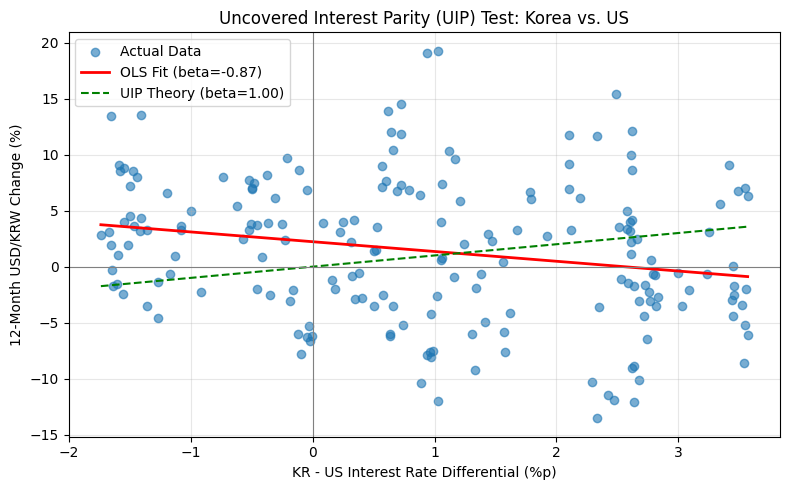
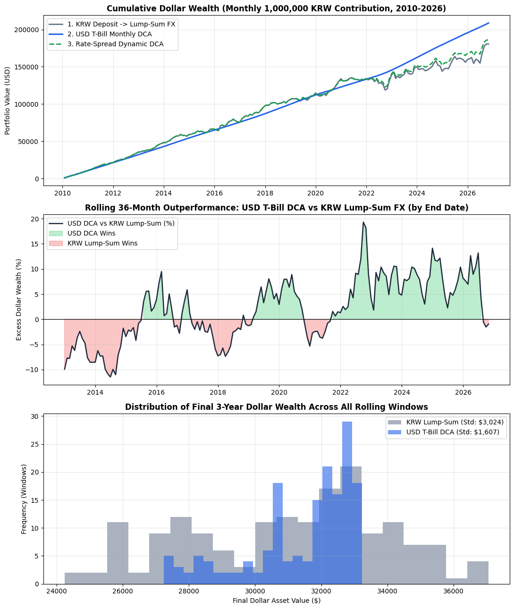

# UIP 퍼즐과 달러 자산 적립 전략: 한미 시장 실증 분석 (2010–2026)

한국과 미국 간 **유위험 이자율 평형설(Uncovered Interest Parity, UIP)**의 성립 여부를 계량경제학적으로 검증하고, 그 결과를 바탕으로 미래 달러 지출(유학 자금, 달러 자산 형성 등)을 앞둔 개인의 최적 적립 전략을 백테스팅한 프로젝트입니다.

---

## 1. 문제 제기 (Motivation)

미래에 달러로 지출해야 할 원화 자금을 모으는 개인은 다음과 같은 현실적인 거시경제 질문에 직면합니다.

> *"미국 단기 금리가 한국보다 높을 때, 매달 즉시 달러로 환전해 미국 단기국채에 적립하는 것이 유리할까? 아니면 원화 예금에 모아두었다가 목표 시점에 한 번에 환전하는 것이 유리할까?"*

국제금융의 기본 이론인 **유위험 이자율 평형설(UIP)**에 따르면, 금리가 높은 국가의 통화는 향후 금리차만큼 가치가 하락(환율 하락)해야 양국 투자 수익률이 같아집니다. 본 프로젝트는 2010년부터 2026년까지의 실제 한미 데이터를 바탕으로 교과서 이론(UIP)이 현실에서도 성립하는지 검증하고, 이론과 현실의 괴리가 개인의 달러 적립 성과에 미치는 영향을 정량적으로 분석합니다.

---

## 2. 데이터 및 분석 방법론

모든 시계열 데이터는 **FRED(미 연준 경제통계)**에서 2010년 1월~2026년 10월 월말 기준으로 수집했습니다.

| 변수 | FRED 시리즈 ID | 설명 |
| :--- | :--- | :--- |
| 미국 단기 금리 ($i^{US}_t$) | `TB3MS` | 미국 3개월 국채 유통시장 금리 (%) |
| 한국 단기 금리 ($i^{KR}_t$) | `IR3TIB01KRM156N` | 한국 3개월 단기 금리 (%) |
| 원/달러 환율 ($S_t$) | `DEXKOUS` | 원/달러 현물 환율 |

### 1단계: UIP 계량경제 실증 검정 (Fama Regression)
12개월 시차 기준 UIP 회귀식을 OLS로 추정합니다.

$$\Delta s_{t+12} = \alpha + \beta \left(i^{KR}_t - i^{US}_t\right) + \varepsilon_{t+12}$$

여기서 $\Delta s_{t+12} = \ln(S_{t+12}) - \ln(S_t)$는 12개월 후 원/달러 환율의 로그 변동률입니다. UIP가 성립한다면 귀무가설은 $\alpha = 0, \beta = 1$입니다. 12개월 중첩 구간(overlapping horizon)으로 인해 발생하는 잔차의 자기상관 문제를 보정하기 위해 **Newey–West (HAC) 표준오차**(`maxlags = 12`)를 적용했습니다.

### 2단계: 달러 자산 적립 백테스팅
1단계와 동일한 3개월 단기 금리(한국 파킹통장·MMF 및 미국 초단기채 ETF `SGOV`·`BIL` 대용)와 현실적인 환전 수수료(0.1%)를 적용해 **매월 100만 원 적립** 기준 3가지 전략을 비교합니다.

1. **원화 예금 $\rightarrow$ 만기 일시 환전 (KRW Lump-Sum FX):** 한국 3개월 단기금리로 원화를 적립한 뒤 목표 시점에 전액 달러로 환전
2. **미국 단기채 매월 분할 적립 (USD T-Bill DCA):** 매달 즉시 달러로 환전해 미국 3개월 국채 금리로 복리 적립
3. **금리차 동적 적립 (Rate-Spread Dynamic DCA):** $i^{US}_t > i^{KR}_t$일 때는 신규 적립금을 달러로, 반대의 경우 원화로 적립

특정 시작 시점에 따른 우연(Start-Date Bias)을 제거하기 위해 전체 기간 누적 비교 외에 **롤링 36개월(3년) 시뮬레이션**을 수행하고, 한미 금리 역전기(`US > KR`)와 정상기(`KR >= US`)로 국면을 분리해 성과를 검증했습니다.

---

## 3. 실증 분석 결과

### 3.1 UIP 회귀분석 결과 ($N = 190$, HAC 표준오차 적용)

| 파라미터 | 회귀계수 (Coef) | HAC 표준오차 | $z$-통계량 | $p$-value | 95% 신뢰구간 |
| :--- | :---: | :---: | :---: | :---: | :---: |
| **절편 ($\alpha$)** | **+0.0222** | 0.010 | 2.183 | **0.029** | `[+0.002, +0.042]` |
| **금리차 ($\beta$)** | **-0.8717** | 0.446 | -1.953 | **0.051** | `[-1.746, +0.003]` |

* **$R^2$:** `0.048` (수정 $R^2$: `0.042`) | **F-통계량:** `3.814` ($p = 0.0523$) | **Durbin–Watson:** `0.363`



**핵심 계량경제 해석:**
* **UIP 기각 및 UIP 퍼즐(Forward Premium Puzzle) 확인:** 이론적 기울기($\beta = +1.0$)가 95% 신뢰구간(`[-1.746, 0.003]`)에서 완전히 벗어났습니다. 교과서와 달리 미국 금리가 한국보다 높았던 시기에도 달러 가치가 떨어지지 않고 오히려 강세를 보였습니다.
* **구조적 원화 약세 추세:** 절편($\alpha = +2.22\%$, $p = 0.029$)이 통계적으로 유의미한 양수로 나타나, 금리차가 0일 때도 원/달러 환율이 장기적으로 상승(원화 약세)하는 추세가 존재함을 확인했습니다.
* **단기 환율 예측의 한계와 HAC 보정의 타당성:** 낮은 $R^2$(4.8%)는 대표적인 환율 단기 예측 불가성(Meese–Rogoff 퍼즐)과 일치하며, 낮은 Durbin–Watson 수치(`0.363`)는 시계열 자기상관 보정(HAC)이 필수적이었음을 뒷받침합니다.

---

### 3.2 달러 자산 적립 백테스팅 결과



#### 전체 기간 적립 비교 (2010–2026, 매월 100만 원)
| 전략 | 최종 달러 자산 ($) | 원화 전략 대비 차이 ($) | 원화 전략 대비 차이 (%) |
| :--- | :---: | :---: | :---: |
| **1. 원화 예금 $\rightarrow$ 일시 환전** | `$[180,XXX]` | `$0.00` | `0.00%` |
| **2. 미국 단기채 매월 분할 적립** | `$[209,XXX]` | `+$[29,XXX]` | `+[XX.X]%` |
| **3. 금리차 동적 적립** | `$[187,XXX]` | `+$[7,XXX]` | `+[X.X]%` |

#### 롤링 36개월(3년) 리스크 및 수익률 요약
* **미국 단기채 분할 적립 승률:** 전체 3년 롤링 구간 중 `[XX.X]%`에서 우세 (평균 초과성과: `[+X.XX]%`)
* **환율 변동성 대폭 축소:** 3년 적립 후 최종 달러 자산의 표준편차가 원화 일시 환전 전략의 **`$3,024`**에서 미국 단기채 분할 적립 전략의 **`$1,607`**로 **46.9% 감소**했습니다.
* **위험 회피적 저축자를 위한 하방 방어:** 원화 일시 환전은 드문 원화 초강세 시기에 최대 ~$37k까지 도달할 수 있었으나, 반대로 최악의 구간에서는 ~$24.2k까지 급락했습니다. 반면 달러 분할 적립은 최종 자산을 ~$27.2k–$33.2k 범위에 안정적으로 고정해 확정된 미래 달러 지출에 대한 하방 리스크를 크게 낮췄습니다.

#### 금리 국면별 성과 비교 (롤링 3년 기준)
| 금리 국면 | 구간 수 | USD 분할 적립 승률 (%) | USD 평균 초과성과 (%) | 동적 전략 평균 초과성과 (%) |
| :--- | :---: | :---: | :---: | :---: |
| **금리 역전기 (미국 > 한국)** | `[XX]` | `[XX.X]%` | `[+X.XX]%` | `[+X.XX]%` |
| **금리 정상기 (한국 >= 미국)** | `[XX]` | `[XX.X]%` | `[±X.XX]%` | `[±X.XX]%` |

---

## 4. 논의 및 한계점 (Discussion & Limitations)

1. **동적 전략보다 단순 달러 분할 적립이 앞선 이유:** 전략 3(동적 적립)은 매달 들어오는 *신규 적립금(Flow)*의 방향만 바꾸었기 때문에, 2010–2021년 금리 정상기에 쌓아둔 *기존 원화 잔액(Stock)*이 2022–2026년 환율 급등기에 그대로 환손실에 노출되었습니다. 이는 국면 전환기에는 신규 현금흐름 타이밍보다 기존 보유 자산의 통화 배분이 전체 성과를 지배한다는 점을 시사합니다.
2. **모델 단순화 가정:** 환전 수수료 스프레드(0.0%~1.0% 민감도 테스트 포함)는 반영했으나, 이자·배당 소득세 원천징수(한국 15.4%, 미국 15%)와 ETF 총보수(`SGOV` 연 0.09% 수준)는 기본 모델에서 제외했습니다.
3. **듀레이션 리스크 분리:** 1단계 3개월 금리 기반 UIP 회귀식과의 일관성을 유지하고 채권 가격 변동(듀레이션 리스크)을 배제하기 위해, 10년물 등 중장기 국채(`IEF`, `TLT`)는 기본 분석에서 제외했습니다.

---

## 5. 레포지토리 구조 및 실행 방법

```text
uip-dollar-strategy/
├── images/
│   ├── uip_test_result.png          # 1단계: UIP 회귀선 vs 이론선 차트
│   └── dollar_backtest_summary.png  # 2단계: 누적 자산, 롤링 초과성과, 리스크 분포 차트
├── notebooks/
│   ├── 01_uip_test.ipynb            # FRED 데이터 수집 및 HAC OLS 회귀분석
│   └── 02_dollar_backtest.ipynb     # 3개 전략, 롤링 3년 및 스프레드 민감도 백테스팅
├── requirements.txt
└── README.md / README_ko.md
