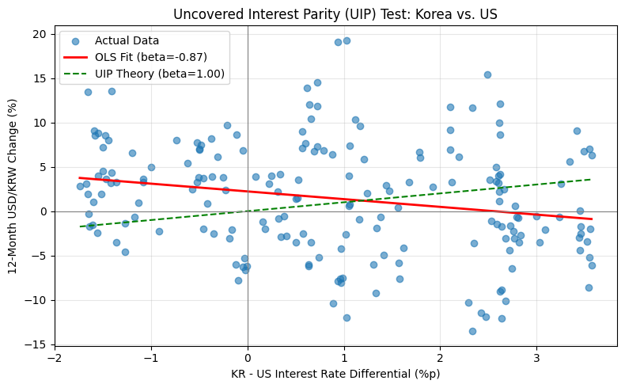
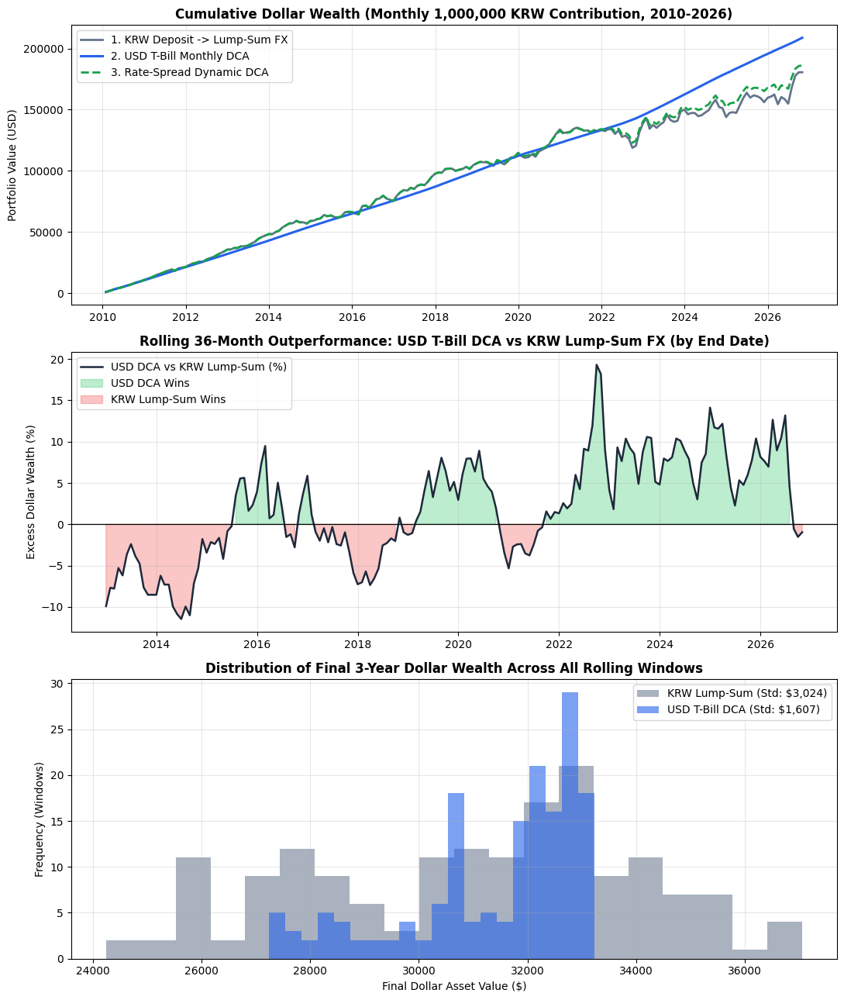

**[English](README.md) | [한국어](README_ko.md)**

# UIP Puzzle & Liability-Matching Dollar Accumulation: Empirical Evidence from Korea–US Markets (2010–2026)

An empirical econometrics and portfolio simulation project testing **Uncovered Interest Parity (UIP)** between South Korea and the United States, and evaluating how **USD T-Bill monthly accumulation** serves as a liability-matching hedge for individuals saving in KRW for future USD obligations (e.g., tuition or living expenses abroad).

> **Core Takeaway:** Rather than promising future excess returns from FX timing, the primary economic case for monthly USD T-Bill accumulation is **liability matching and FX risk reduction**—cutting the standard deviation of 3-year final dollar wealth by **46.9%** (`$3,024` $\rightarrow$ `$1,607`).

---

## 1. Motivation

For Korean residents saving in KRW for fixed future USD expenses, a practical macroeconomic question arises:

> *"When US short-term interest rates exceed Korean rates, should I convert KRW into USD Treasury bills every month, or save in KRW deposits and exchange all at once at the target date?"*

Standard international finance theory—**Uncovered Interest Parity (UIP)**—predicts that higher foreign interest rates should be offset by subsequent depreciation of the foreign currency, equalizing expected returns across currencies. This project tests whether UIP held in Korea–US short-term markets over 2010–2026 and compares accumulation strategies through both **risk (liability matching)** and **historical return** lenses.

---

## 2. Data & Methodology

All time-series data are sourced directly from **FRED (Federal Reserve Economic Data)** at monthly end-of-period frequency (January 2010 – October 2026, 202 months):

| Variable | FRED Series ID | Description |
| :--- | :--- | :--- |
| US Short-Term Rate ($i^{US}_t$) | `TB3MS` | 3-Month US Treasury Bill Secondary Market Rate (%) |
| Korea Short-Term Rate ($i^{KR}_t$) | `IR3TIB01KRM156N` | 3-Month Interbank Rate for South Korea (%) |
| Exchange Rate ($S_t$) | `DEXKOUS` | South Korean Won to US Dollar Spot Exchange Rate |

### Step 1: Econometric Test of UIP (Fama Regression)
We estimate the 12-month overlapping UIP regression via OLS:

$$\Delta s_{t+12} = \alpha + \beta \left(i^{KR}_t - i^{US}_t\right) + \varepsilon_{t+12}$$

where $\Delta s_{t+12} = \ln(S_{t+12}) - \ln(S_t)$ is the 12-month log change in USD/KRW. Under UIP, the joint null hypothesis is $\alpha = 0$ and $\beta = 1$. To account for serial correlation induced by 12-month overlapping horizons, standard errors are adjusted via the **Newey–West (HAC) estimator** (`maxlags = 12`). We explicitly test three distinct hypotheses: (i) $H_0: \beta = 1$ (UIP slope), (ii) $H_0: \alpha = 0, \beta = 1$ (joint Wald test), and (iii) $H_0: \beta = 0$ (forward premium puzzle).

### Step 2: Dollar Accumulation Simulation
Using the same 3-month interest rate series with a 0.1% FX conversion spread, we simulate monthly contributions of **1,000,000 KRW** across four strategies:
1. **KRW Deposit $\rightarrow$ Lump-Sum FX:** Compound in Korean 3-month rates and convert the full balance to USD at the target date.
2. **USD T-Bill Monthly DCA:** Convert monthly contributions immediately into USD and compound at US 3-month T-Bill rates.
3. **3A. Dynamic DCA (Flow-Only):** Direct *new* monthly contributions to USD when $i^{US}_t > i^{KR}_t$, and to KRW otherwise.
4. **3B. Dynamic DCA (Full-Balance Rebalancing):** Switch both *existing balances* and new contributions to the higher-yielding currency upon regime changes (incurring round-trip FX spreads).

Because rolling 36-month windows overlap heavily, we supplement the 167 rolling windows with **5 non-overlapping (independent) 3-year blocks** and a **12-month moving block bootstrap ($B = 2,000$)** to construct 95% confidence intervals.

---

## 3. Empirical Results

### 3.1 UIP Regression Output ($N = 190$ Overlapping Months, $\approx 15.8$ Independent Years)

| Parameter / Hypothesis Test | Estimate / Stat | HAC Std. Error | $z$-stat / $\chi^2$ | $p$-value | 95% CI / Decision |
| :--- | :---: | :---: | :---: | :---: | :---: |
| **Intercept ($\alpha$)** | `+0.0222` | `0.010` | $z = 2.183$ | `0.029` | `[+0.002, +0.042]` |
| **Rate Differential ($\beta$)** | `-0.8717` | `0.446` | $z = -1.953$ | `0.051` | `[-1.746, +0.003]` |
| **Test 1: $H_0: \beta = 1$ (UIP Slope)** | $\beta - 1 = -1.8717$ | `0.446` | $z \approx -4.20$ | **`< 0.0001`** | **Strongly Rejected** |
| **Test 2: $H_0: \alpha=0, \beta=1$ (Joint Wald)** | — | — | $\chi^2 = \text{[실행값 입력]}$ | **`[실행값 입력]`** | **Rejected** |
| **Test 3: $H_0: \beta = 0$ (Negative Slope)** | `-0.8717` | `0.446` | $z = -1.953$ | `0.051` | **Borderline (10% level)** |

* **$R^2$:** `0.048` (Adj. $R^2$: `0.042`) | **Durbin–Watson:** `0.363` | **Rate-Diff AR(1) Persistence ($\rho$):** `[실행값 입력]`



**Careful Statistical Interpretation:**
* **Distinguishing UIP Rejection from the Negative Slope:** The theoretical UIP benchmark ($\beta = 1$) is decisively rejected ($z \approx -4.20, p < 0.0001$), and the joint null ($\alpha = 0, \beta = 1$) is likewise rejected by the Wald test. However, the claim that $\beta$ is strictly negative (the classic forward premium puzzle) sits on the statistical boundary ($p = 0.051$ at the 5% level).
* **Small-Sample & Persistence Caveat:** Although the regression uses 190 monthly rows, 12-month overlapping horizons yield only **$\approx 15.8$ effective independent annual observations**. Combined with high interest-rate differential persistence ($\rho = \text{[실행값 입력]}$), finite-sample slope estimates carry substantial uncertainty—consistent with recent UIP reassessments showing that point estimates are sensitive to persistence modeling.

---

### 3.2 Primary Finding: Liability Matching & FX Volatility Reduction



For a saver with fixed future USD obligations (such as overseas tuition), **currency mismatch** is the dominant risk. Holding KRW until the payment date introduces substantial terminal wealth dispersion:

* **46.9% Reduction in Terminal Wealth Volatility:** Across rolling 3-year windows, monthly USD T-Bill accumulation reduced the standard deviation of final dollar wealth from **`$3,024`** (KRW Lump-Sum) to **`$1,607`** (USD DCA). Block-bootstrap simulations confirm a comparable risk reduction (`[실행값 입력]%`).
* **Downside Protection Over Tail Speculation:** While KRW Lump-Sum occasionally achieved higher right-tail outcomes during rare KRW rallies (up to `≈$37k`), it exposed savers to severe left-tail FX drawdowns (down to `≈$24.2k`). Monthly USD DCA anchored final 3-year wealth tightly between `≈$27.2k` and `≈$33.2k`, acting as a **natural liability-matching hedge** regardless of whether FX markets trend favorably in the future.

---

### 3.3 Historical Return Comparison & Statistical Uncertainty

#### A. Rolling 36-Month Windows (167 Overlapping Windows; $\approx 5.6$ Independent Blocks)
| Strategy (vs. KRW Lump-Sum Baseline) | Win Rate | Mean Outperf. | Worst / Best Window | Terminal Std. Dev. |
| :--- | :---: | :---: | :---: | :---: |
| **2. USD T-Bill Monthly DCA** | `57.5%` | `+1.89%` | `-11.48%` / `+19.31%` | **`$1,607`** (vs. `$3,024`) |
| **3A. Dynamic DCA (Flow-Only)** | `48.5%` | `+1.38%` | `[실행값 입력]` | — |
| **3B. Dynamic DCA (Full-Balance Rebal.)** | `[실행값 입력]%` | `[실행값 입력]%` | `[실행값 입력]` | — |

#### B. Addressing Non-Independence: Non-Overlapping 3-Year Blocks & Block Bootstrap
Because 167 overlapping rolling windows correspond to only **5–6 independent 3-year spans**, a 57.5% win rate and +1.89% mean gain (with a `-11.48%` worst case) cannot support a definitive claim of guaranteed return outperformance.

* **Non-Overlapping 3-Year Independent Blocks ($N = 5$):**
  * USD T-Bill DCA: Win Rate `[실행값 입력]%` | Mean Outperformance `[실행값 입력]%`
  * Dynamic 3B (Full-Balance Rebalancing): Win Rate `[실행값 입력]%` | Mean Outperformance `[실행값 입력]%`
* **12-Month Moving Block Bootstrap ($B = 2,000$ simulations, preserving autocorrelation):**
  * USD T-Bill DCA Mean: `[실행값 입력]%` | **95% CI:** `[ [실행값 입력]%, [실행값 입력]% ]` | Bootstrap Win Rate: `[실행값 입력]%`
  * Dynamic 3B Mean: `[실행값 입력]%` | **95% CI:** `[ [실행값 입력]%, [실행값 입력]% ]` | Bootstrap Win Rate: `[실행값 입력]%`

#### C. Interest-Rate Regime Breakdown (Rolling 3-Year)
| Regime | Windows | USD DCA Win Rate | Avg. USD Outperf. | Avg. 3A Outperf. | Avg. 3B Outperf. |
| :--- | :---: | :---: | :---: | :---: | :---: |
| **KR Rate $\ge$ US Rate (Normal)** | 117 | `45.3%` | `+0.07%` | `+0.23%` | `[실행값 입력]%` |
| **US Rate $>$ KR Rate (Inversion)** | 50 | `86.0%` | `+6.13%` | `+4.07%` | `[실행값 입력]%` |

#### D. Single-Path Full-Period Accumulation (2010–2026, 202 Months, 1M KRW/month)
| Strategy | Final USD Value ($) | Diff vs. KRW ($) | Diff vs. KRW (%) |
| :--- | :---: | :---: | :---: |
| **1. KRW Deposit $\rightarrow$ Lump-Sum FX** | `$180,572.43` | `$0.00` | `0.00%` |
| **2. USD T-Bill Monthly DCA** | `$208,760.48` | `+$28,188.04` | `+15.61%` |
| **3A. Dynamic DCA (Flow-Only)** | `$186,158.63` | `+$5,586.19` | `+3.09%` |
| **3B. Dynamic DCA (Full-Balance Rebal.)** | `$[실행값 입력]` | `[실행값 입력]` | `[실행값 입력]%` |

> **Path-Dependence Note:** The full-period `+15.61%` gain reflects a **single realized historical path** heavily influenced by secular KRW depreciation during 2010–2026. In-sample UIP rejection does not guarantee future return superiority.

#### E. Transaction Cost Sensitivity (Proportional FX Spread: 0.0%–1.0%)
Under a purely proportional one-way conversion fee ($s$) with no fixed per-transaction charge, both monthly DCA and lump-sum FX scale final USD wealth by the identical factor $(1+s)^{-1}$. Thus, relative performance (`57.49%` win rate, `+1.89%` mean) is scale-invariant across proportional spreads from `0.0%` to `1.0%`. Fixed per-wire fees or round-trip conversions (as in Strategy 3B) do introduce real drag.

---

## 4. Limitations & Methodological Caveats

1. **No Out-of-Sample (OOS) Validation:** All regressions and backtests are in-sample (2010–2026). Historical USD strength should not be extrapolated as a persistent alpha source; the robust conclusion is risk reduction via liability matching.
2. **Strategy 1 Yield Proxy Bias (Conservative Toward KRW):** Using Korea's 3-month interbank rate (`IR3TIB01KRM156N`) typically overstates the interest rate available to retail depositors in ordinary bank accounts. This introduces a **conservative bias in favor of Strategy 1 (KRW)**—meaning real-world retail KRW savings would likely trail slightly further behind USD T-Bill ETFs.
3. **Flow-Only (3A) vs. Full-Balance Rebalancing (3B):** Strategy 3A underperformed because existing KRW balances built during 2010–2021 remained exposed during the 2022–2026 USD surge. Including Strategy 3B provides a fairer dynamic benchmark while accounting for round-trip conversion spreads across `[실행값 입력]` regime switches.
4. **Omitted Frictions & Duration Scope:** Domestic interest/dividend withholding taxes (15.4% KR / 15% US) and ETF expense ratios (`≈0.09%` for `SGOV`) are excluded. Longer-duration bonds (e.g., 10Y `IEF`) are intentionally omitted to isolate FX/short-rate mechanics from bond price duration risk.

---

## 5. Repository Structure & Reproduction

```text
UIP-dollar-strategy/
├── images/
│   ├── uip_test_result.png          # Step 1: UIP OLS vs. Theoretical Line
│   └── dollar_backtest_summary.png  # Step 2: Cumulative, Rolling & Risk Histograms
├── notebooks/
│   ├── 01_uip_test.ipynb            # FRED ingestion, HAC OLS & Wald diagnostics
│   └── 02_dollar_backtest.ipynb     # 4-strategy, non-overlapping & block bootstrap
├── LICENSE
├── requirements.txt
└── README.md / README_ko.md
```

### Quick Start
```bash
git clone [https://github.com/mingikwak/UIP-dollar-strategy.git](https://github.com/mingikwak/UIP-dollar-strategy.git)
cd UIP-dollar-strategy
pip install -r requirements.txt
```

---

## Disclaimer
*This project is intended solely for academic and educational research purposes and does not constitute financial, tax, or investment advice.*
