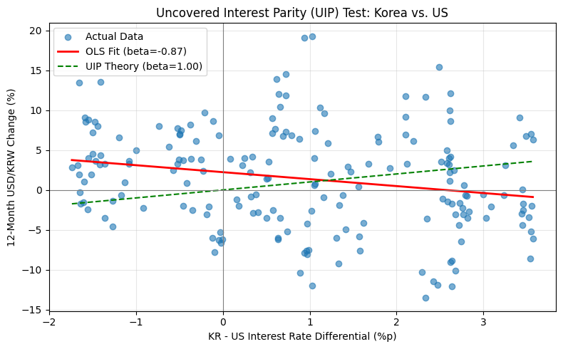
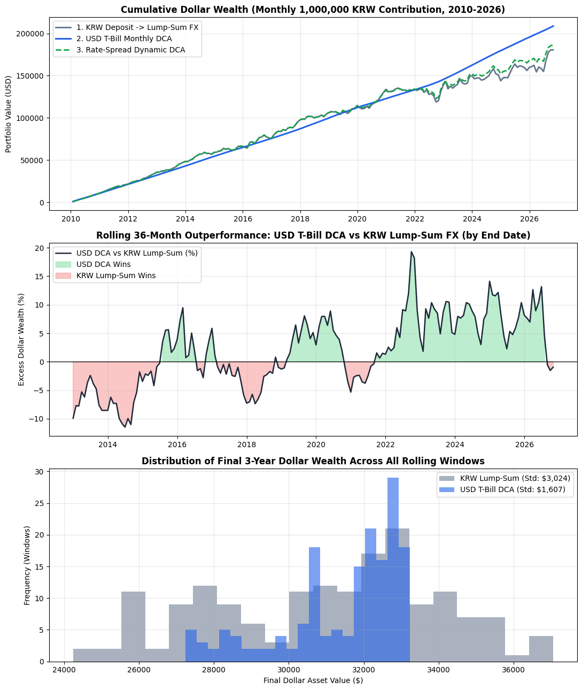

**[English](README.md) | [한국어](README_ko.md)**

# UIP 퍼즐과 부채 매칭 달러 적립 전략: 한미 시장 실증 분석 (2010–2026)

한국과 미국 간 **유위험 이자율 평형설(Uncovered Interest Parity, UIP)**의 성립 여부를 계량경제학적으로 검증하고, 미래 달러 지출(유학 등록금·생활비 등)을 앞둔 개인에게 **미국 단기국채 분할 적립**이 어떤 **부채 매칭(Liability Matching) 헤지 효과**를 제공하는지 분석한 프로젝트입니다.

> **핵심 결론:** 본 프로젝트는 환율 타이밍을 통한 미래 초과수익을 주장하지 않습니다. 미국 단기국채 매월 분할 적립의 가장 탄탄한 경제학적 근거는 **미래 달러 부채와의 통화 일치(자연 헤지)를 통한 변동성 46.9% 축소**(`$3,024` $\rightarrow$ `$1,607`)입니다.

---

## 1. 문제 제기 (Motivation)

미래에 확정된 달러 지출을 앞두고 원화로 자금을 모으는 개인은 다음 질문에 직면합니다.

> *"미국 단기 금리가 한국보다 높을 때, 매달 즉시 달러로 환전해 미국 단기국채에 적립하는 것이 나을까? 아니면 원화 예금에 모으다가 목표 시점에 한 번에 환전하는 것이 나을까?"*

국제금융의 기본 이론인 **유위험 이자율 평형설(UIP)**은 고금리 통화의 가치가 향후 금리차만큼 하락해 양국 기대수익률이 같아진다고 예측합니다. 본 프로젝트는 2010–2026년 한미 단기금리·환율 데이터로 UIP를 엄밀하게 검정하고, 적립 전략을 **리스크(부채 매칭)**와 **역사적 성과** 양면에서 평가합니다.

---

## 2. 데이터 및 분석 방법론

모든 시계열 데이터는 **FRED(미 연준 경제통계)**에서 2010년 1월–2026년 10월 월말 기준(총 202개월)으로 수집했습니다.

| 변수 | FRED 시리즈 ID | 설명 |
| :--- | :--- | :--- |
| 미국 단기 금리 ($i^{US}_t$) | `TB3MS` | 미국 3개월 국채 유통시장 금리 (%) |
| 한국 단기 금리 ($i^{KR}_t$) | `IR3TIB01KRM156N` | 한국 3개월 단기(은행간) 금리 (%) |
| 원/달러 환율 ($S_t$) | `DEXKOUS` | 원/달러 현물 환율 |

### 1단계: UIP 계량경제 실증 검정 (Fama Regression)
12개월 중첩 구간 기준 UIP 회귀식을 OLS로 추정합니다.

$$\Delta s_{t+12} = \alpha + \beta \left(i^{KR}_t - i^{US}_t\right) + \varepsilon_{t+12}$$

여기서 $\Delta s_{t+12} = \ln(S_{t+12}) - \ln(S_t)$는 12개월 후 환율의 로그 변동률입니다. 12개월 중첩으로 인한 잔차 자기상관을 보정하기 위해 **Newey–West (HAC) 표준오차**(`maxlags = 12`)를 적용했으며, (i) $H_0: \beta = 1$(UIP 기울기), (ii) $H_0: \alpha = 0, \beta = 1$(공동 Wald 검정), (iii) $H_0: \beta = 0$(음수 기울기 여부)의 세 가설을 명확히 분리해 검정합니다.

### 2단계: 달러 자산 적립 시뮬레이션
동일한 3개월 단기 금리와 환전 스프레드 0.1%를 적용해 **매월 100만 원 적립** 기준 4가지 전략을 비교합니다.
1. **원화 예금 $\rightarrow$ 만기 일시 환전:** 한국 3개월 금리로 원화 적립 후 목표 시점에 전액 달러 환전
2. **미국 단기채 매월 분할 적립 (USD DCA):** 매달 즉시 달러로 환전해 미국 3개월 국채 금리로 복리 적립
3. **3A. 금리차 동적 적립 (신규 납입분만 전환):** $i^{US}_t > i^{KR}_t$일 때 *신규 적립금(Flow)*만 달러로 투입
4. **3B. 금리차 동적 적립 (기존 잔고 전액 리밸런싱):** 국면 전환 시 *기존 잔고(Stock)*까지 왕복 환전 수수료를 지불하고 고금리 통화로 전액 이동

롤링 36개월 구간은 서로 크게 겹쳐 독립 표본이 아니므로, 167개 롤링 결과에 더해 **5개의 비중첩(독립) 3년 구간**과 **12개월 이동 블록 부트스트랩($B = 2,000$회)** 95% 신뢰구간을 함께 보고합니다.

---

## 3. 실증 분석 결과

### 3.1 UIP 회귀분석 결과 (중첩 190개월, 실질 독립 관측치 $\approx 15.8$년)

| 파라미터 / 가설 검정 | 추정치 / 통계량 | HAC 표준오차 | $z$ / $\chi^2$ 통계량 | $p$-value | 95% 신뢰구간 / 판정 |
| :--- | :---: | :---: | :---: | :---: | :---: |
| **절편 ($\alpha$)** | `+0.0222` | `0.010` | $z = 2.183$ | `0.029` | `[+0.002, +0.042]` |
| **금리차 ($\beta$)** | `-0.8717` | `0.446` | $z = -1.953$ | `0.051` | `[-1.746, +0.003]` |
| **검정 1: $H_0: \beta = 1$ (UIP 기울기)** | $\beta - 1 = -1.8717$ | `0.446` | $z \approx -4.20$ | **`< 0.0001`** | **강하게 기각** |
| **검정 2: $H_0: \alpha=0, \beta=1$ (공동 Wald)** | — | — | $\chi^2 = \text{[실행값 입력]}$ | **`[실행값 입력]`** | **기각** |
| **검정 3: $H_0: \beta = 0$ (음수 기울기)** | `-0.8717` | `0.446` | $z = -1.953$ | `0.051` | **경계선 (5% 유의수준 미달)** |

* **$R^2$:** `0.048` (수정 $R^2$: `0.042`) | **Durbin–Watson:** `0.363` | **금리차 AR(1) 지속성 ($\rho$):** `[실행값 입력]`



**통계적 해석 시 유의할 점:**
* **'UIP 기각'과 '음수 기울기'의 구분:** 이론적 기준인 $\beta = 1$은 확실히 기각되며($z \approx -4.20, p < 0.0001$), 공동 Wald 검정($\alpha=0, \beta=1$) 역시 기각됩니다. 반면 기울기가 엄밀히 음수($\beta < 0$, Forward Premium Puzzle)라는 주장은 $p = 0.051$로 5% 유의수준의 경계선에 있어 단정적으로 해석하지 않고 구분해 보고합니다.
* **소표본 및 지속성 한계:** 중첩 관측치는 190개월이지만 12개월 중첩 구조상 실질적인 독립 관측치는 **약 15.8년 분량**에 불과합니다. 또한 금리차의 자기상관 지속성($\rho = \text{[실행값 입력]}$)이 높을수록 소표본 기울기 추정치가 크게 흔들릴 수 있다는 최근 UIP 재검토 연구들의 지적을 함께 고려해야 합니다.

---

### 3.2 핵심 결과: 부채 매칭과 환율 변동성 축소



미래에 달러로 지출해야 하는 개인에게 가장 치명적인 위험은 **통화 불일치(Currency Mismatch)**입니다. 원화로만 모으다 만기에 일시 환전할 경우 최종 달러 구매력의 변동 폭이 극심해집니다.

* **최종 달러 자산 변동성 46.9% 감소:** 롤링 3년 적립 기준, 최종 달러 자산의 표준편차가 원화 일시 환전의 **`$3,024`**에서 미국 단기채 분할 적립의 **`$1,607`**로 거의 절반 가까이 줄었습니다. 블록 부트스트랩 시뮬레이션에서도 동일한 수준의 변동성 축소(`[실행값 입력]%`)가 확인됩니다.
* **상방 투기보다 하방 방어:** 원화 일시 환전은 드문 원화 초강세 구간에서 최대 `≈$37k`까지 도달할 수 있었으나, 최악의 구간에서는 `≈$24.2k`까지 급락했습니다. 반면 달러 분할 적립은 최종 자산을 `≈$27.2k–$33.2k` 범위에 안정적으로 고정해, 향후 환율 방향과 무관하게 **부채 매칭형 자연 헤지**로 작동했습니다.

---

### 3.3 역사적 수익률 비교 및 통계적 불확실성

#### A. 롤링 36개월 요약 (167개 중첩 구간, 실질 독립 구간 $\approx 5.6$개)
| 전략 (원화 일시 환전 대비) | 승률 | 평균 초과성과 | 최악 / 최선 구간 | 최종 자산 표준편차 |
| :--- | :---: | :---: | :---: | :---: |
| **2. 미국 단기채 매월 분할 적립** | `57.5%` | `+1.89%` | `-11.48%` / `+19.31%` | **`$1,607`** (원화 `$3,024`) |
| **3A. 금리차 동적 적립 (신규분만)** | `48.5%` | `+1.38%` | `[실행값 입력]` | — |
| **3B. 금리차 동적 적립 (전액 리밸런싱)** | `[실행값 입력]%` | `[실행값 입력]%` | `[실행값 입력]` | — |

#### B. 비독립성 보완: 비중첩 3년 독립 구간 & 블록 부트스트랩
167개 롤링 구간은 한 달씩 밀며 만든 중첩 표본이라 실질 독립 구간은 5–6개 수준입니다. 최악 구간(`-11.48%`)도 존재하는 만큼, 승률 57.5%와 평균 +1.89%만으로 수익률 우세를 단정하기 어렵습니다.

* **비중첩(독립) 3년 구간 ($N = 5$):**
  * 미국 단기채 분할 적립: 승률 `[실행값 입력]%` | 평균 초과성과 `[실행값 입력]%`
  * 전략 3B (전액 리밸런싱): 승률 `[실행값 입력]%` | 평균 초과성과 `[실행값 입력]%`
* **12개월 이동 블록 부트스트랩 ($B = 2,000$회, 자기상관 보존):**
  * 미국 단기채 분할 적립 평균: `[실행값 입력]%` | **95% 신뢰구간:** `[ [실행값 입력]%, [실행값 입력]% ]` | 승률: `[실행값 입력]%`
  * 전략 3B 평균: `[실행값 입력]%` | **95% 신뢰구간:** `[ [실행값 입력]%, [실행값 입력]% ]` | 승률: `[실행값 입력]%`

#### C. 금리 국면별 성과 분해 (롤링 3년)
| 금리 국면 | 구간 수 | USD 분할 승률 | USD 평균 초과 | 3A 평균 초과 | 3B 평균 초과 |
| :--- | :---: | :---: | :---: | :---: | :---: |
| **금리 정상기 (한국 $\ge$ 미국)** | 117 | `45.3%` | `+0.07%` | `+0.23%` | `[실행값 입력]%` |
| **금리 역전기 (미국 $>$ 한국)** | 50 | `86.0%` | `+6.13%` | `+4.07%` | `[실행값 입력]%` |

#### D. 전체 기간 단일 경로 누적 결과 (2010–2026, 총 202개월, 매월 100만 원)
| 전략 | 최종 달러 자산 ($) | 원화 전략 대비 ($) | 원화 전략 대비 (%) |
| :--- | :---: | :---: | :---: |
| **1. 원화 예금 $\rightarrow$ 일시 환전** | `$180,572.43` | `$0.00` | `0.00%` |
| **2. 미국 단기채 매월 분할 적립** | `$208,760.48` | `+$28,188.04` | `+15.61%` |
| **3A. 금리차 동적 적립 (신규분만)** | `$186,158.63` | `+$5,586.19` | `+3.09%` |
| **3B. 금리차 동적 적립 (전액 리밸런싱)** | `$[실행값 입력]` | `[실행값 입력]` | `[실행값 입력]%` |

> **경로 의존성 유의:** 전체 기간의 `+15.61%` 격차는 2010–2026년 원화 약세 흐름이 반영된 **단일 실현 경로의 결과**입니다. 표본 내 UIP 기각이 향후 달러 적립의 수익률 우위를 보장하지는 않습니다.

#### E. 환전 수수료 민감도 (비율 스프레드 0.0%–1.0%)
건당 고정 수수료 없이 환전액에 비례하는 단방향 스프레드($s$)만 적용하면 분할 적립과 일시 환전 모두 최종 달러 자산이 동일하게 $(1+s)^{-1}$배 축소됩니다. 따라서 비율 스프레드 0.0%–1.0% 전 구간에서 상대 성과(`57.49%` 승률, `+1.89%` 평균)는 동일하며, 실제 비용 차이는 건당 고정 송금 수수료나 전략 3B처럼 왕복 환전이 발생할 때 나타납니다.

---

## 4. 방법론적 한계 및 논의 (Limitations)

1. **표본 외(Out-of-Sample) 검증 부재:** 모든 회귀분석과 백테스팅은 2010–2026년 표본 내(In-Sample) 결과입니다. 과거 달러 강세를 미래 수익률로 일반화할 수 없으며, 핵심 결론은 수익률 추구가 아닌 **부채 매칭 기반 리스크 축소**에 있습니다.
2. **전략 1 금리 대용치 편향 (원화 전략에 유리한 보수적 설정):** 한국 3개월 은행간 금리(`IR3TIB01KRM156N`)는 일반 개인이 시중 은행 예금에서 받는 수신금리보다 대체로 높게 형성됩니다. 이는 **전략 1(원화)의 성과를 실제보다 높게 추정하는 보수적 편향**으로 작용합니다.
3. **전략 3A vs 3B 공정성 비교:** 신규 납입분만 전환한 전략 3A는 기존 원화 잔고가 2022–2026년 환율 급등에 노출되는 구조적 열위가 있었습니다. 기존 잔고까지 왕복 수수료를 내고 전환하는 전략 3B(총 `[실행값 입력]`회 전환)를 함께 비교해 공정성을 보완했습니다.
4. **미반영 마찰 요인 및 듀레이션 제외:** 이자·배당 원천징수세(한국 15.4%, 미국 15%) 및 ETF 총보수(`SGOV` 연 `≈0.09%`)는 제외했습니다. 10년물 등 장기채(`IEF`)는 채권 가격 변동(듀레이션 리스크)과 환율 효과를 분리하기 위해 기본 모델에서 제외했습니다.

---

## 5. 레포지토리 구조 및 실행 방법

```text
UIP-dollar-strategy/
├── images/
│   ├── uip_test_result.png          # 1단계: UIP 회귀선 vs 이론선 차트
│   └── dollar_backtest_summary.png  # 2단계: 누적 자산, 롤링 초과성과, 리스크 분포 차트
├── notebooks/
│   ├── 01_uip_test.ipynb            # FRED 데이터 수집, HAC OLS 및 Wald 검정
│   └── 02_dollar_backtest.ipynb     # 4개 전략, 비중첩 3년 및 블록 부트스트랩
├── LICENSE
├── requirements.txt
└── README.md / README_ko.md
```

### 빠른 실행
```bash
git clone [https://github.com/mingikwak/UIP-dollar-strategy.git](https://github.com/mingikwak/UIP-dollar-strategy.git)
cd UIP-dollar-strategy
pip install -r requirements.txt
```

---

## 면책 조항 (Disclaimer)
*본 저장소는 학술 및 교육적 연구 목적으로만 작성되었으며, 어떠한 금융·세무·투자 조언도 제공하지 않습니다.*
